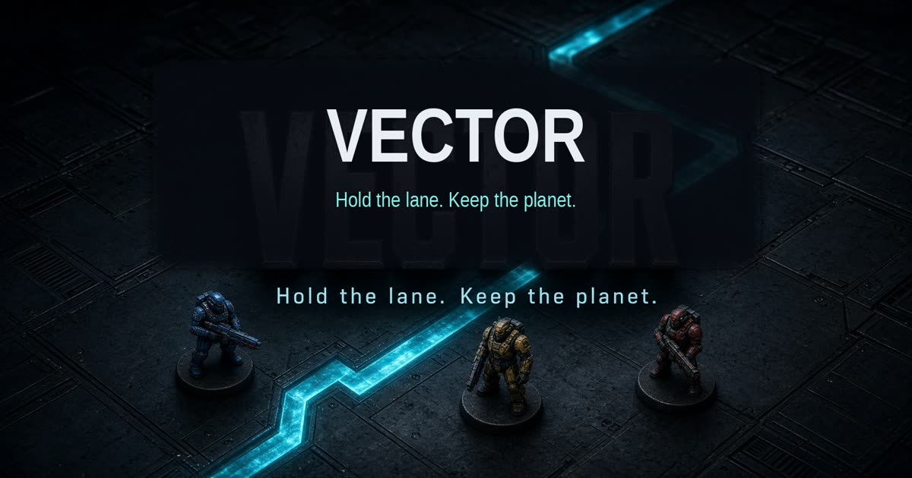

<div align="center">

# VECTOR

**Draft once. Plant guns on moons. Hold 12.**



A browser tower defense game built on a card draft.
Build your hand before the fight, then level it up while the waves keep coming.

`v0.9.1` · No account needed · Plays on desktop and phone

</div>

---

## The idea

VECTOR combines three things:

| | |
|---|---|
| 🃏 **Card drafting** | Before the fight you draft a small hand: guns, then Signals. That hand is your whole plan. The waves don't stop so you can draw more. |
| 🌑 **Tower defense** | Plant guns on lit moons and hold the lane for 12 waves. |
| 🌳 **Leveling and skill trees** | Kills pay Credit and fill your Level. Spend Credit on gun and craft skill trees and element infusions in the middle of a run. |

---

## Modes

| Mode | How it plays |
|---|---|
| **Arena** | Draft your whole hand up front, then hold 12 waves. |
| **Build** | Start with two guns. Draft one gun after every wave. Copies of a gun you own merge: **3 copies = ★2, 9 = ★3**. Each star multiplies the gun's damage and opens another tree pick. Hold 12. |

### Threat (opt-in difficulty)
Tap **Threat** on the title screen to turn on modifiers (tougher enemies, faster enemies, fewer lives, pricier trees, no Orders, bigger mega waves, escorts, mutant affixes). Each point pays +10% Vault Credit and Pass XP. Past wave 12, enemy HP also grows 6% per wave.

### Campaign
Tap **Campaign** on the title screen. 15 hand-set stages in 3 sectors (Tide Line, Dark Side, Lagrange). Each stage fixes the map, the lane, the mode (Arena or Build), the wave count (6, 9 or 12) and its own Threat; your Threat toggles are left alone. Win a stage to score up to 3 ★: ★1 for holding every wave, ★2 for staying under a leak cap, ★3 for that stage's twist (no leaks, tree picks, reactions, Build merges, fewest guns, a time limit or a Credit budget). Stages open in order once the one before has a ★; Dark Side opens at 8 ★, Lagrange at 20 ★. Each new ★ pays 15 Vault Credit, a first clear pays 40 Pass XP, and all 15 ★ in a sector pays a reward (Ember skin, 300 Credit, Gold skin). Replays pay normal run rewards. Stage data lives in `src/game/data/campaign.ts`; reward numbers are in `PARAMS` (`campaign*`).

### Special enemies
- **Blink** — every 3 s it jumps 140 path units up its lane; a marker flickers at the landing spot for 0.4 s first. Fragile. Cover the late lane or burst it. Arena / Build from wave 6; Campaign from Dark Side.
- **Jammer** — every 4.5 s it pulses: guns within 130 units hold fire for 1.5 s (Home and crafts are immune; a gun gets 2 s clear before it can be jammed again). Tanky and slow. Outrange it or focus it. Arena / Build from wave 8; Campaign in Lagrange.

Numbers are in `PARAMS` (`blink*`, `jam*`); Campaign stages list them in `extra` (`src/game/data/campaign.ts`).

## Orders
Active abilities you cast in combat from one shared **Energy** meter (0–100). Energy resets to 50 at each wave start (one Stasis ready) (no hoarding), then refills +1/s while a wave runs, +1 per kill, +8 per Hulk / Titan / Jammer kill and +2 per element reaction. Every cast starts a 3 s lockout for all Orders.

| Order | Cost | Target | Effect |
|---|---|---|---|
| **Stasis Net** (Cryo) | 50 | lane | after 0.6 s, r90: freeze 1.6 s (Hulk/Titan 0.6 s), marks Cryo, cancels a Blink jump or Jammer pulse that is about to go off |
| **Lance Strike** (Plasma) | 60 | lane | after 1.0 s, r70: 12% max HP (bosses 4%) through armor, marks Plasma (Cryo-marked → Shatter) |
| **Surge** (Volt) | 40 | a gun | 5 s: fire rate ×1.6, jam-proof, clears its jam, shots carry Volt; then 2 s overheat (holds fire) |
| **Recall Gate** | 45 | lane | after 0.5 s, r80: knocks non-boss enemies 160 back along the lane (same fade/floor as gun knockback) |

Every run starts with Stasis Net in slot 1; at run Level 3 you pick a second Order from the other three. Tap a button (or press **1** / **2**) to arm, then tap the lane or a gun; a miss or **Escape** disarms. The **Radio Silence** threat (+1) turns Orders off. Numbers live in `src/game/data/orders.ts` (`ORDER_NUM`).

## How a run works

1. **Pick a craft.** It's already flying.
2. **Draft.** Your first pick is two guns that work together. Then fill the empty moons. Your last two picks are **Signals**.
3. **Plant and defend.** Put guns on lit moons and hit **Defend**.
4. **Level up.** Spend Credit from kills on a gun's skill tree while the run is going.
5. **Hold 12.** Survive 12 waves to win. Then keep flying for score, or go back and draft again.

---

## Progression

### Gun skill trees: during the run
Every gun has its own tree with **3 branches × 3 nodes**. Each pick costs Credit, and the cost goes up as the gun learns more jobs. Commit to a branch to give the gun a role, like deeper pierce or armor crack.

### Craft skill trees: during the run
Crafts get trees too: 3 picks across at most 2 branches. Auger, Torch and Boost have their own; every other craft gets Bite / Reach / Hull. Tap a flying craft to open its tree.

### Elements
Infuse any gun with one element it isn't already: **Plasma** (fire, shots burn), **Cryo** (ice, shots chill) or **Volt** (shock, shots jump once). An infused gun counts toward that element's combo.

Two elements on one enemy **react**:

| Pair | Reaction |
|---|---|
| Plasma + Cryo | **Shatter** — a burst of damage |
| Cryo + Volt | **Brittle** — armor stripped |
| Plasma + Volt | **Overload** — a blast hits enemies nearby |

### Level
Kills fill the Level bar. Each Level pays Credit, and Levels 4, 5 and 8 unlock a better draft, an extra pick and an extra moon.

### Vault: between runs
Spend leftover Credit in the Vault. The first Vault purchases unlock after a few wins.

---

### Season pass: across runs
A free 30-tier season track (**Season 1 · Neon Drift**). Every run earns Pass XP: 10 per wave cleared, +50 for holding 12, +5 per ★ made in Build. Each tier pays out when the run ends: Vault Credit, Vault looks (paths, trails, frames, stars, sun), craft skins and badges. Looks only — nothing on the pass makes guns stronger. Open it from **Pass** on the title screen.

## Signals

A Signal is a rule for this run, not a gun. You pick two, and they stay on for the whole run.

> "+6% damage" is not a Signal. "Ion jumps one extra time" is.

Same guns + different Signals = a different run.

---

## On a phone

The draft shows one card at a time. **Swipe** to see the next card. **Tap** the card to flip it. **Take** is its own button.

---

## Run it

```bash
npm install
npm run dev        # dev server on port 8080
```

```bash
npm run typecheck
npm run build
```

The version lives in `src/game/version.ts` and shows on the title screen.
Saves stay in the browser.

---

## Look

See the approved [voxel art direction](docs/art-direction.md) and [isolated render prototype](prototypes/render/) (not part of the game build).

Neon vector. Everything on the board is a glowing outline on near-black with a faint grid: cyan for your side (guns, crafts, Home), magenta for enemies and their lane, element colors only where they mean something. Enemy shape tells you the type (triangle grunt, chevron striker, square plate, hexagon colossus, octagon titan, four-point spark Blink, pentagon Jammer). Cards show the same vector glyphs. Drawing lives in `src/game/neon.ts`; set `NEON_LOOK = false` there to get the old painted look back. The old painted card art is kept in `art-src/cards`.

## Where things are

| What | Where |
|---|---|
| Rules and sim | `src/game/` |
| Card, Signal and tree data | `src/game/data/` |
| Screens | `src/components/game/` |
| Card and enemy art | `public/game/` (original card paintings in `art-src/cards`) |
| Design notes | `PLAN.md`, `FUN-PLAN.md` |
