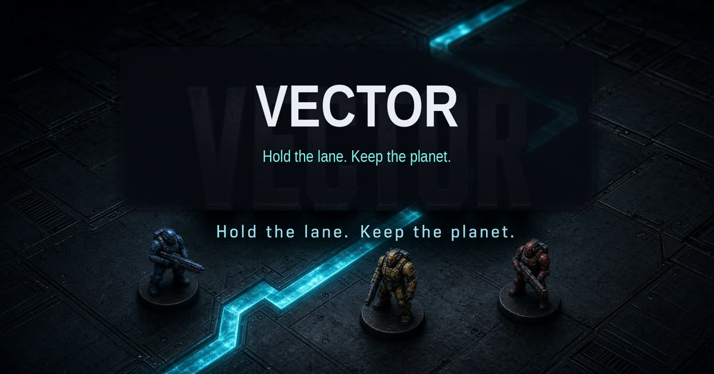

<div align="center">

# VECTOR

**Draft once. Plant guns on moons. Hold 12.**



A browser tower defense game built on a card draft.
Build your hand before the fight, then level it up while the waves keep coming.

`v0.9.1` · No account needed · Plays on desktop and phone

</div>

---

## The idea

VECTOR combines three things:

| | |
|---|---|
| 🃏 **Card drafting** | Before the fight you draft a small hand: guns, then Signals. That hand is your whole plan. The waves don't stop so you can draw more. |
| 🌑 **Tower defense** | Plant guns on lit moons and hold the lane for 12 waves. |
| 🌳 **Leveling and skill trees** | Kills pay Credit. Spend it to walk a planted gun up its skill tree in the middle of a run, and climb ranks that make later drafts stronger. |

---

## How a run works

1. **Pick a craft.** It's already flying.
2. **Draft.** Your first pick is two guns that work together. Then fill the empty moons. Your last two picks are **Signals**.
3. **Plant and defend.** Put guns on lit moons and hit **Defend**.
4. **Level up.** Spend Credit from kills on a gun's skill tree while the run is going.
5. **Hold 12.** Survive 12 waves to win. Then keep flying for score, or go back and draft again.

---

## Progression

### Gun skill trees: during the run
Every gun has its own tree with **3 branches × 3 nodes**. Each pick costs Credit, and the cost goes up as the gun learns more jobs. Commit to a branch to give the gun a role, like deeper pierce or armor crack.

### Climb: rank up
Climb picks raise your ranks in three branches:

| Branch | What it improves |
|---|---|
| **Bay** | Moons and home |
| **Pack** | Richer drafts |
| **Crew** | Crafts in the air |

### Vault: between runs
Spend leftover Credit in the Vault. The first Vault purchases unlock after a few wins.

---

## Signals

A Signal is a rule for this run, not a gun. You pick two, and they stay on for the whole run.

> "+6% damage" is not a Signal. "Ion jumps one extra time" is.

Same guns + different Signals = a different run.

---

## On a phone

The draft shows one card at a time. **Swipe** to see the next card. **Tap** the card to flip it. **Take** is its own button.

---

## Run it

```bash
npm install
npm run dev        # dev server on port 8080
```

```bash
npm run typecheck
npm run build
```

The version lives in `src/game/version.ts` and shows on the title screen.
Saves stay in the browser.

---

## Where things are

| What | Where |
|---|---|
| Rules and sim | `src/game/` |
| Card, Signal and tree data | `src/game/data/` |
| Screens | `src/components/game/` |
| Card and enemy art | `public/game/` |
| Design notes | `PLAN.md`, `FUN-PLAN.md` |
